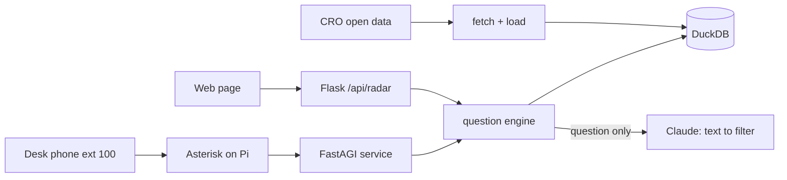

# Filing Radar

Filing Radar lets a busy accountant ask, on a web page or by dialling extension 100 on their desk phone, which clients are about to miss a CRO filing deadline and which overdue local companies could become new clients, and get a short spoken, sourced answer from the free daily company register. It also rings the phone each morning with the deadlines that matter that day.

Built at Corkathon, Cork, 7 November 2026, for the Frame sponsor track and IGNITE Best Startup Potential.

> **Status.** Every Filing Radar feature below is **Planned** unless marked **Built**. What is Built today is the React and Flask scaffold (sign-in, database, CI, one-container deploy), described in [docs/scaffold.md](docs/scaffold.md). Each doc labels every feature, and gets updated as pieces land.

## What it does

| Feature | Status |
|---|---|
| **Prospects mode**: "Which Cork hospitality companies are overdue on their annual return?" returns a ranked list of new-business leads | Planned |
| **Clients mode**: upload your client company numbers, ask "Who do I need to chase this week?" | Web UI built (client list on `/app`, questions on `/app/radar`), API Planned |
| **Honesty panel**: every web answer shows the filter that was run, the SQL, the row count and the data snapshot date | Web UI built at `/app/radar`, API Planned |
| **Desk phone**: dial 100, press 1 (this week's deadlines), 2 (overdue Cork companies) or 3 (ask a question out loud) | Planned |
| **Morning briefing**: the phone rings and reads the day's key deadlines | Planned. The same briefing on screen is the Today page at `/app` (web UI built, API Planned) |
| **Company brief**: click a company for status, filing history and sector | Planned (stretch) |

## How it works in 60 seconds

1. A script downloads the CRO "Company Records" open dataset (CC BY 4.0) and loads it into a local DuckDB file. A freshness check flags the snapshot as stale if its newest registration is more than about 7 days old.
2. Rules in code add derived fields: days to the next annual return date, overdue flag, days overdue, estimated late penalty, Eircode routing key and NACE sector label.
3. A question in plain English goes to Claude, which may only answer with a JSON filter that must pass a fixed schema. **The model never computes dates, money or counts.**
4. Code turns the filter into parameterised SQL, runs it on DuckDB, and writes the answer sentence from the result rows, always with the row count and snapshot date.
5. The same engine answers the web page (React on Flask) and the desk phone (a Cisco IP phone wired to a Raspberry Pi running Asterisk, with speech to text going in and Piper text to speech coming out).



Full detail: [docs/02-architecture.md](docs/02-architecture.md).

## Quickstart

You need [Bun](https://bun.sh) and [uv](https://docs.astral.sh/uv/getting-started/installation).

Set up the scaffold (**Built**):

```bash
bun install
bun run setup
```

Add your Claude API key to `.env` (**Planned**, nothing reads it yet):

```bash
echo "ANTHROPIC_API_KEY=sk-ant-..." >> .env
```

Fetch and load the data (**Planned**):

```bash
bun run radar:fetch
bun run radar:check
```

Run the backend and web page (**Built** for the scaffold, the Radar page is **Planned**):

```bash
bun run dev
```

Open http://localhost:5173, sign in, and go to `/app/radar`.

Call extension 100 (**Planned**): set up the Pi as described in [docs/06-runbook.md](docs/06-runbook.md), then pick up the desk phone and dial `100`.

## Docs

| Doc | What is in it |
|---|---|
| [01-overview](docs/01-overview.md) | Problem, users, the two modes, how we meet each judging criterion |
| [02-architecture](docs/02-architecture.md) | Components and the flows for web, phone and morning briefing |
| [03-data](docs/03-data.md) | Dataset, fields, licence, freshness gate, derived field formulas |
| [04-question-engine](docs/04-question-engine.md) | Filter schema, prompt, guardrails, SQL templates, test questions |
| [05-telephony](docs/05-telephony.md) | Phone network, Asterisk config, dialplan, AGI contract, audio |
| [06-runbook](docs/06-runbook.md) | Setup from zero, env vars, troubleshooting, pre-demo checklist |
| [07-demo-and-pitch](docs/07-demo-and-pitch.md) | 3-minute script, stage setup, backups |
| [08-limits-and-roadmap](docs/08-limits-and-roadmap.md) | What it cannot do, what comes next |
| [09-judge-qa](docs/09-judge-qa.md) | Likely judge questions and answers |
| [10-devpost](docs/10-devpost.md) | Ready-to-paste Devpost sections |
| [decisions](docs/decisions.md) | Short decision records |
| [scaffold](docs/scaffold.md) | The underlying React and Flask scaffold, commands, deploy |

## Team

Placeholder: add the three team names and roles here.

## Data attribution

Contains Companies Registration Office data, used under CC BY 4.0. See [docs/03-data.md](docs/03-data.md) for the exact attribution text.

> **VERIFY:** the attribution wording the CRO asks for on its open data portal.
