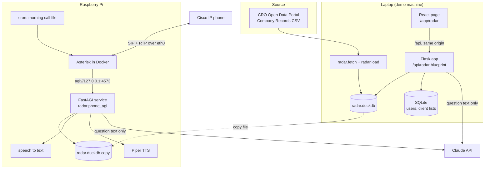
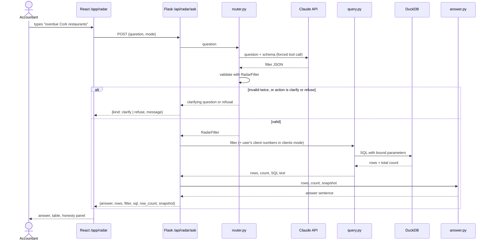
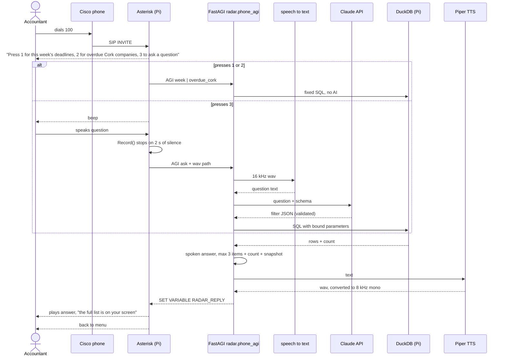
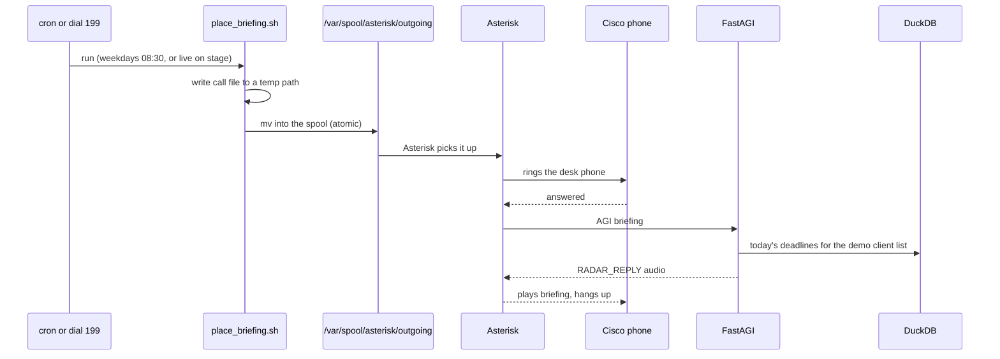

# Architecture

Everything on this page is **Planned** unless marked **Built**. The scaffold it sits on (Flask app factory, sign-in, SQLite, React shell, CI) is **Built**, see [scaffold.md](scaffold.md).

## Components



| Component | Where | What it does | Status |
|---|---|---|---|
| Flask app | `apps/api/corkathon_api/app.py` | App factory, sign-in, rate limits, serves the built React app | Built |
| React shell | `apps/web/src/shell/Shell.tsx` | Signed-in layout and nav | Built |
| Radar feature (API) | `apps/api/corkathon_api/features/radar/` | Loader, rules, filter schema, router, query, answer, routes | Planned |
| Radar feature (web) | `apps/web/src/features/radar/`, `apps/web/src/routes/RadarPage.tsx` | Question box, answer, results table, honesty panel, client list upload | Planned |
| DuckDB file | `apps/api/data/radar.duckdb` (gitignored) | The loaded snapshot plus derived fields | Planned |
| Asterisk | `telephony/` on the Pi | Registers the phone, runs the menu dialplan, records questions, plays answers | Planned |
| FastAGI service | `radar.phone_agi`, on the Pi | Takes calls from the dialplan, runs the same engine, returns an audio file | Planned |
| Claude API | external | Turns question text into a filter JSON. Nothing else | Planned |

### Planned module layout

```
apps/api/corkathon_api/features/radar/
  settings.py       RadarSettings, env vars (see 06-runbook)
  fetch.py          download companies.csv.zip from the CRO portal, unzip
  load.py           build radar.duckdb: typed table plus derived columns
  freshness.py      snapshot.json: fetched_at, newest company_reg_date, stale flag
  rules.py          filing window, penalty formula, as-of date
  areas.py          named areas to Eircode routing keys
  nace.py           NACE v2 code to sector label
  filter_schema.py  RadarFilter pydantic model, the one source of the JSON Schema
  router.py         question text to RadarFilter via Claude
  query.py          RadarFilter to parameterised SQL
  answer.py         rows to a web sentence or a spoken sentence
  models.py         ClientCompany rows, one per user per company number
  routes.py         /api/radar blueprint
  speech.py         speech to text and Piper wrappers
  phone_agi.py      FastAGI server for Asterisk
  briefing.py       morning briefing text
  demo_clients.py   writes a sample client list for the demo
apps/web/src/features/radar/
  radar-api.ts      zod schemas and calls
  AskPanel.tsx  ResultsTable.tsx  HonestyPanel.tsx  ClientListPanel.tsx
telephony/
  compose.yml  asterisk/  callfiles/  dnsmasq/  sounds/
```

This follows the repo rule of one folder per feature (see `AGENTS.md`). `features/notes` is the template and gets deleted once Radar needs the space.

### Why the engine runs in two places

The venue wifi may block devices from talking to each other (client isolation). So the laptop and the Pi do not depend on reaching each other. Both run the same Python package against their own copy of the same `radar.duckdb`, and both reach the internet only for the Claude API. The phone is wired straight into the Pi. See [decisions.md](decisions.md#direct-phone-to-pi-network).

## Web question flow



### Planned API

| Method and path | Auth | Body or query | Returns |
|---|---|---|---|
| `POST /api/radar/ask` | `@jwt_required()` | `{question: string (1-300 chars), mode: "clients" \| "prospects"}` | `{kind: "answer", answer, rows, filter, sql, row_count, snapshot}` or `{kind: "clarify" \| "refuse", message, snapshot}` |
| `GET /api/radar/snapshot` | `@jwt_required()` | none | `{fetched_at, newest_reg_date, stale}` |
| `GET /api/radar/clients` | `@jwt_required()` | none | the signed-in user's company numbers |
| `PUT /api/radar/clients` | `@jwt_required()` | `{company_numbers: string[]}`, max 2,000 | replaces the signed-in user's list |
| `GET /api/radar/companies/<num>` | `@jwt_required()` | none | one company brief (stretch) |

Client lists are user data, so every query filters by `signed_in_user().id`, and `routes_test.py` proves user B cannot read user A's list (repo rule in `AGENTS.md`).

Planned `AppError` codes: `radar_question_invalid`, `radar_llm_unavailable`, `radar_no_clients`, `radar_data_missing`, `radar_company_not_found`. The web client switches on `code`, never on the message.

## Phone call flow



If speech to text or Claude fails or takes too long, the service returns a prerecorded "I could not work that out, press 1 or 2" prompt. Detail in [05-telephony.md](05-telephony.md).

## Morning briefing flow



The live trigger on stage is dialling `199` on the desk phone: Asterisk runs `place_briefing.sh 10`, the presenter hangs up, and the phone rings 10 seconds later. See [05-telephony.md](05-telephony.md#morning-briefing).
