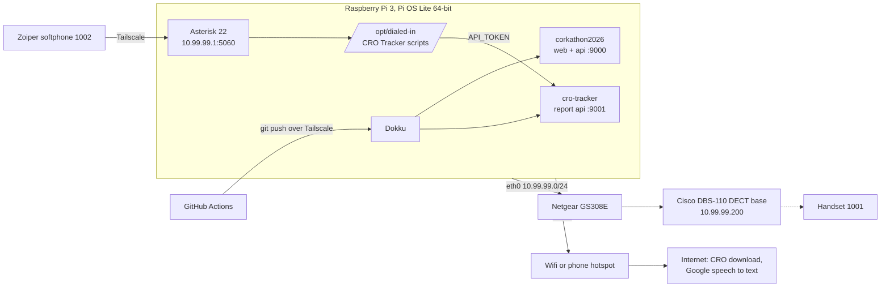

# Deployment

How to stand up the whole of Dialed-In on a fresh Raspberry Pi: the web app, the CRO Tracker API, the phone system and the CRO Tracker phone line. Each step is a script in [`infra/`](../../infra/README.md) plus the few things a script cannot do (flashing the SD card, pairing a handset).

## What runs where



## Order

| Step | Doc | Time |
|---|---|---|
| 1 | [Pi base: OS, network, Tailscale, Piper](01-pi.md) | 30 min |
| 2 | [Asterisk: build, config, DECT base, softphone](02-asterisk.md) | 1 to 2 hours, mostly compiling |
| 3 | [Dokku and the two apps](03-dokku-and-apps.md) | 30 min |
| 4 | [CRO Tracker phone line](04-phone.md) | 15 min plus the first pre-render |
| 5 | [GitHub Actions deploys](05-github-actions.md) | 10 min |

Once all five are done, a push to `main` redeploys both apps by itself. The phone scripts and Asterisk config are not deployed by CI: after changing anything in `infra/`, pull on the Pi and rerun the matching script.

## Redeploying an existing Pi

```bash
cd ~/corkathon2026 && git pull
sudo bash infra/asterisk/install.sh      # dialplan changes
sudo bash infra/asterisk/make_prompts.sh # any new prompts
sudo bash infra/phone/deploy.sh          # phone scripts and cron
sudo bash infra/pi/harden.sh             # ssh, firewall, security updates
```

All three are safe to rerun and keep existing passwords, settings and recorded prompts.

## Hardware

- Raspberry Pi 3 (1 GB), 7-inch screen optional
- Cisco IP DECT DBS-110 base station and one handset
- Netgear GS308E 8-port switch (not PoE, so the base needs its own power supply)
- A laptop for the base's web page and SSH, and a phone for the hotspot and Zoiper
