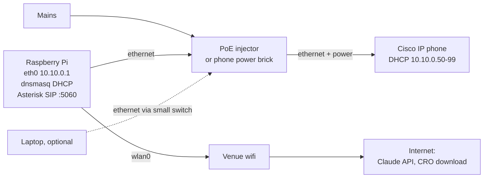
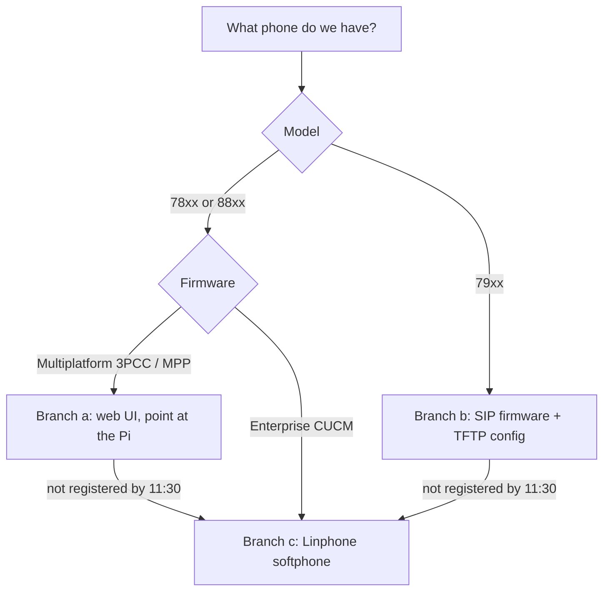

# Telephony

## What was built

The phone system that runs today differs from the plan below:

| Plan below | Built |
|---|---|
| Cisco desk phone on `201`, PoE injector | Cisco DBS-110 DECT base and handset on `1001`, Zoiper softphone on `1002` |
| Pi LAN `10.10.0.0/24`, dnsmasq | Pi LAN `10.99.99.0/24`, NetworkManager shared mode |
| Asterisk in Docker | Asterisk 22 built from source, under systemd |
| FastAGI service in the API | Asterisk runs `infra/phone/transcribe_audio.py` per question; answers pre-rendered with Piper |
| Linphone fallback | Zoiper over a Tailscale subnet route |

The config is in [infra/asterisk](../../infra/asterisk) and [infra/phone](../../infra/phone/README.md), and the setup steps are in [deployment](../deployment/README.md). The rest of this page is the original plan, kept for the design reasoning, and is **Planned**.

## Numbers on the phone

| Number | What it is |
|---|---|
| `201` | The desk phone's own SIP account |
| `100` | Dialed-In menu |
| `199` | Books a morning briefing call in 10 seconds (for testing) |

The plan said "endpoint for ext 100". The phone cannot be both the caller and the number it dials, so the phone registers as `201` and `100` is a dialplan extension.

## Network topology

The venue wifi probably blocks devices from reaching each other (client isolation), so the phone never touches it. It is plugged straight into the Pi.



- `eth0` on the Pi: static `10.10.0.1/24`, dnsmasq hands out `10.10.0.50` to `10.10.0.99`.
- `wlan0` on the Pi: venue wifi, used only for outbound internet.
- Asterisk's SIP transport binds to `10.10.0.1` only, so nothing on the venue wifi can reach it.
- To reach the Pi from the laptop without the venue network, put a small unmanaged switch between the injector and the Pi and plug the laptop in too. The laptop gets a `10.10.0.x` address.

### Power

Cisco desk phones usually take power over ethernet. Bring one of:

- an 802.3af (or 802.3at) PoE injector, which sits between the Pi and the phone, or
- the phone's own power brick, if the model has a power socket.

> **VERIFY:** the power class our phone model needs, and that the injector we have supplies it.

### Pi network setup

Pi OS Bookworm uses NetworkManager.

```bash
sudo nmcli con add type ethernet ifname eth0 con-name radar-lan ipv4.method manual ipv4.addresses 10.10.0.1/24 ipv4.never-default yes ipv6.method disabled
sudo nmcli con up radar-lan
sudo apt update && sudo apt install -y dnsmasq sox
sudo cp telephony/dnsmasq/radar-lan.conf /etc/dnsmasq.d/radar-lan.conf
sudo systemctl restart dnsmasq
```

`telephony/dnsmasq/radar-lan.conf`:

```ini
interface=eth0
bind-interfaces
# dhcp only, the pi keeps its normal dns
port=0
dhcp-range=10.10.0.50,10.10.0.99,255.255.255.0,12h
dhcp-option=option:router,10.10.0.1

# only for branch b, 79xx phones that load config over tftp
# enable-tftp
# tftp-root=/srv/tftp
# dhcp-option=66,"10.10.0.1"
# dhcp-option=150,10.10.0.1
```

Find the phone's address once it boots:

```bash
cat /var/lib/misc/dnsmasq.leases
```

## Asterisk in Docker

Asterisk may not be in the default Pi OS apt repositories, so it runs in a container. Host networking avoids NAT trouble with RTP audio.

```bash
curl -fsSL https://get.docker.com | sh
sudo usermod -aG docker "$USER"
```

Log out and back in, then:

```bash
sudo mkdir -p /srv/radar/audio/in /srv/radar/audio/out
sudo chmod 777 /srv/radar/audio/in /srv/radar/audio/out
cd telephony && docker compose up -d
docker compose logs -f asterisk
```

`telephony/compose.yml`:

```yaml
services:
  asterisk:
    # pin an exact tag, see the verify note
    image: andrius/asterisk:REPLACE_WITH_TAG
    network_mode: host
    restart: unless-stopped
    volumes:
      - ./asterisk/pjsip.conf:/etc/asterisk/pjsip.conf:ro
      - ./asterisk/pjsip.secrets.conf:/etc/asterisk/pjsip.secrets.conf:ro
      - ./asterisk/extensions.conf:/etc/asterisk/extensions.conf:ro
      - ./asterisk/rtp.conf:/etc/asterisk/rtp.conf:ro
      - ./sounds:/var/lib/asterisk/sounds/radar:ro
      - ./callfiles:/opt/radar:ro
      - /srv/radar/audio:/srv/radar/audio
```

> **VERIFY:** which Asterisk image to use and that it has an arm64 build. `andrius/asterisk` is a candidate, not checked. Pin the exact tag.

`/srv/radar/audio` has the same path inside and outside the container, so a file path the FastAGI service writes is a path Asterisk can play.

## Phone model branches



### a) 78xx or 88xx with multiplatform (3PCC / MPP) firmware

1. Boot the phone on the Pi's network and read its address from the dnsmasq leases.
2. Open `http://<phone address>/admin/advanced` in a browser on a laptop plugged into the switch.
3. Under Voice, Ext 1: set Proxy to `10.10.0.1`, User ID and Auth ID to `201`, Password to the one in `pjsip.secrets.conf`, Make Call Without Reg to `no`, Register to `yes`.
4. Submit. The line key turns green when registered. Check from the Pi:

```bash
docker compose exec asterisk asterisk -rx "pjsip show contacts"
```

> **VERIFY:** the exact menu names on our firmware version. The steps above are from memory of the MPP admin page.

> **VERIFY:** if the phone is a 78xx or 88xx on enterprise firmware, whether moving it to MPP needs a Cisco migration licence. If it does, go straight to branch c.

### b) Older 79xx on enterprise firmware

These phones speak SCCP out of the box. To register them with Asterisk they need SIP firmware loaded and a `SEP<MAC>.cnf.xml` config served over TFTP (enable the TFTP lines in `radar-lan.conf`). Getting the firmware and the XML right usually takes hours. **Recommendation: do not attempt this on the day.** Go to branch c at 11:30.

### c) Fallback: Linphone softphone

1. Install Linphone on a laptop or phone.
2. Connect it to the Pi's network: laptop on the switch, or a phone through a USB ethernet adapter.
3. Add a SIP account: username `201`, domain `10.10.0.1`, password from `pjsip.secrets.conf`, transport UDP.
4. Dial `100`.

## Asterisk config

`telephony/asterisk/pjsip.conf`:

```ini
[transport-udp]
type=transport
protocol=udp
; phone lan only, never the venue wifi
bind=10.10.0.1:5060

[201]
type=endpoint
transport=transport-udp
context=radar
disallow=all
allow=ulaw,alaw
auth=201-auth
aors=201
direct_media=no
rtp_symmetric=yes
force_rport=yes
rewrite_contact=yes

[201]
type=aor
max_contacts=1
remove_existing=yes

#include pjsip.secrets.conf
```

`telephony/asterisk/pjsip.secrets.conf` (gitignored; commit only `pjsip.secrets.conf.example`):

```ini
[201-auth]
type=auth
auth_type=userpass
username=201
password=REPLACE_WITH_A_LONG_RANDOM_PASSWORD
```

Generate the password with `openssl rand -hex 16`.

`telephony/asterisk/rtp.conf`:

```ini
[general]
rtpstart=10000
rtpend=10100
```

`telephony/asterisk/extensions.conf`:

```ini
[radar]
exten => 100,1,Answer()
 same => n,Wait(1)
 same => n,Goto(radar-menu,s,1)

exten => 199,1,Answer()
 same => n,System(/opt/radar/place_briefing.sh 10)
 same => n,Playback(radar/briefing-booked)
 same => n,Hangup()

[radar-menu]
exten => s,1,Set(TIMEOUT(digit)=3)
 same => n,Set(TIMEOUT(response)=8)
 same => n,Background(radar/menu)
 same => n,WaitExten()

exten => 1,1,Playback(radar/one-moment)
 same => n,AGI(agi://127.0.0.1:4573/week)
 same => n,Playback(${RADAR_REPLY})
 same => n,Goto(s,1)

exten => 2,1,Playback(radar/one-moment)
 same => n,AGI(agi://127.0.0.1:4573/overdue_cork)
 same => n,Playback(${RADAR_REPLY})
 same => n,Goto(s,1)

exten => 3,1,Playback(radar/ask-after-beep)
 ; stop after 2 s of silence or 15 s total, asterisk plays the beep
 same => n,Record(/srv/radar/audio/in/q-${UNIQUEID}.wav,2,15)
 same => n,Playback(radar/one-moment)
 same => n,AGI(agi://127.0.0.1:4573/ask,/srv/radar/audio/in/q-${UNIQUEID}.wav)
 same => n,Playback(${RADAR_REPLY})
 same => n,Goto(s,1)

exten => i,1,Playback(radar/invalid)
 same => n,Goto(s,1)

exten => t,1,Playback(radar/goodbye)
 same => n,Hangup()

[radar-briefing]
exten => s,1,Answer()
 same => n,Wait(1)
 same => n,AGI(agi://127.0.0.1:4573/briefing)
 same => n,Playback(${RADAR_REPLY})
 same => n,Hangup()
```

Prompts in `telephony/sounds/` (`menu`, `one-moment`, `ask-after-beep`, `invalid`, `goodbye`, `briefing-booked`, `sorry`) are generated once with Piper and committed as 8 kHz WAV files:

| Prompt | Text |
|---|---|
| `menu` | "Dialed-In. Press 1 for this week's deadlines. Press 2 for overdue Cork companies. Press 3 to ask a question." |
| `one-moment` | "One moment, checking the register." |
| `ask-after-beep` | "Ask your question after the beep." |
| `invalid` | "Sorry, that is not an option." |
| `goodbye` | "Goodbye." |
| `briefing-booked` | "Your briefing call is on its way. Hang up now." |
| `sorry` | "Sorry, I could not work that out. Press 1 or 2 instead." |

## FastAGI service

Asterisk runs in a container, the engine is Python on the host. FastAGI joins them: the dialplan's `AGI(agi://127.0.0.1:4573/...)` opens a TCP connection to a small server on the Pi, so the container needs no Python, DuckDB or Piper.

```bash
uv run --directory apps/api python -m corkathon_api.features.radar.phone_agi
```

The FastAGI protocol is plain text over TCP (read `agi_*` header lines until a blank line, send commands, read `200 result=` replies), so `phone_agi.py` speaks it directly with `socketserver` and adds no dependency.

### Contract

| | |
|---|---|
| Listens on | `127.0.0.1:RADAR_AGI_PORT` (default 4573), loopback only |
| Input: `agi_network_script` | `week`, `overdue_cork`, `ask` or `briefing` |
| Input: `agi_arg_1` | for `ask`, the recording path; must start with `/srv/radar/audio/in/` or it is rejected |
| Input: `agi_uniqueid` | names the reply file |
| Output: `SET VARIABLE RADAR_REPLY` | absolute path without extension, e.g. `/srv/radar/audio/out/1731000000.12`, or `/var/lib/asterisk/sounds/radar/sorry` on any failure |
| Output: `SET VARIABLE RADAR_STATUS` | `ok`, `stale`, `fallback` |
| Time budget | 12 s in total: speech to text 4 s, Claude 6 s, query and Piper the rest |
| Errors | Never raised to Asterisk. Any exception or timeout logs the error and returns the `sorry` prompt |
| Cleanup | Deletes the question recording after transcribing it, and reply files older than one hour |

### Fixed queries (no AI)

| Script | Filter |
|---|---|
| `week` | `{"action":"query","mode":"clients","deadline_window_days":7,"sort":"deadline_soonest","limit":3}` on the demo client list |
| `overdue_cork` | `{"action":"query","mode":"prospects","overdue_only":true,"area":"cork_county","sort":"most_overdue","limit":3}` |
| `briefing` | two queries on the demo client list: overdue clients, then `deadline_window_days: 7` |

These are `RadarFilter` constants in `phone_agi.py` and go through the same `query.py` as the web. Only `ask` calls speech to text and Claude.

The phone has no sign-in, so clients mode on the phone reads the list at `RADAR_PHONE_CLIENTS` (default `apps/api/data/demo_clients.csv`, written by `bun run radar:demo-clients`).

## Audio formats

| Stage | Format | Conversion |
|---|---|---|
| Asterisk recording | WAV, 8 kHz, 16-bit, mono | none, this is what `Record(...wav)` writes |
| whisper.cpp input | WAV, 16 kHz, 16-bit, mono | `sox in.wav -r 16000 -c 1 -b 16 in16.wav` |
| Piper output | WAV at the voice's sample rate (often 22.05 kHz) | `sox piper.wav -r 8000 -c 1 -b 16 reply.wav` |
| Asterisk playback | WAV, 8 kHz, 16-bit, mono | `Playback()` takes the path without `.wav` |

## Piper TTS

> **VERIFY:** the Piper release to install on arm64 and the voice to use. Pick an `en_GB` voice and check it reads Irish place names acceptably. Piper is a new dependency, so ask the team first.

```bash
sudo mkdir -p /srv/radar/piper && sudo chown "$USER" /srv/radar/piper
cd /srv/radar/piper
# download the linux aarch64 piper release and one voice (.onnx and .onnx.json) here
echo "Dialed-In test." | ./piper/piper --model ./voice.onnx --output_file test.wav
sox test.wav -r 8000 -c 1 -b 16 test8k.wav
```

Set `PIPER_BIN=/srv/radar/piper/piper/piper` and `PIPER_VOICE=/srv/radar/piper/voice.onnx`.

## Speech to text

**Choice: TBD, decide by 14:30 after timing it on our Pi.**

| | whisper.cpp on the Pi | Cloud speech to text API |
|---|---|---|
| Network | none needed | needs the venue wifi |
| Speed | depends on model size and Pi model; `tiny.en` or `base.en` for short questions | usually fast |
| Accuracy on short phone audio | lower with small models, 8 kHz audio upsampled | usually better |
| Cost | free | per minute |
| Privacy | audio stays on the Pi | audio leaves the building |
| Setup risk | building on arm64 and getting the model | another API key |

Leaning towards whisper.cpp with `base.en`, since Claude already needs the network and keeping one fewer external service makes the demo safer. If a 5-second question takes more than about 4 seconds to transcribe on the Pi, use `tiny.en` or cut option 3.

> **VERIFY:** the whisper.cpp binary name in the version we build (recent versions ship `whisper-cli`) and the transcription time on our Pi.

```bash
git clone https://github.com/ggerganov/whisper.cpp /srv/radar/whisper.cpp
cd /srv/radar/whisper.cpp
cmake -B build && cmake --build build -j --config Release
sh ./models/download-ggml-model.sh base.en
./build/bin/whisper-cli -m models/ggml-base.en.bin -f samples/jfk.wav -nt
```

Set `WHISPER_BIN` and `WHISPER_MODEL` to the binary and model paths.

## Spoken answer style

| Rule | Example |
|---|---|
| Lead with the count | "Four clients have a deadline this week." |
| At most 3 items | "The first three are..." |
| Then the rest as a number | "...and one more." |
| Dates spoken naturally | "Friday the 14th", never "2026-11-14" |
| Money rounded and hedged | "about 136 euro" |
| Drop company suffixes | "Harbour Cafe", not "HARBOUR CAFE LIMITED" |
| Say how fresh the data is | "From this morning's register." or "From the register on Thursday the 5th." |
| End every menu answer with | "The full list is on your screen." |
| Under 20 seconds | answer.py trims to fit |

Example, option 2 (placeholder company names):

> "Twelve Cork companies are overdue on their annual return. The most overdue is Placeholder Bakery, 140 days late, estimated penalty about 520 euro. Then Placeholder Hotel, 96 days late, and Placeholder Motors, 61 days late. From this morning's register. The full list is on your screen."

## Morning briefing

The Pi places an outbound call by dropping a call file into Asterisk's outgoing spool.

`telephony/callfiles/place_briefing.sh` (runs inside the Asterisk container):

```sh
#!/bin/sh
set -eu
delay="${1:-0}"
mkdir -p /var/spool/asterisk/tmp
tmp="/var/spool/asterisk/tmp/briefing-$$.call"
cat > "$tmp" <<EOF
Channel: PJSIP/201
CallerID: "Dialed-In" <100>
MaxRetries: 1
RetryTime: 60
WaitTime: 30
Context: radar-briefing
Extension: s
Priority: 1
EOF
# asterisk waits until the file's modified time before dialling
touch -d "@$(( $(date +%s) + delay ))" "$tmp"
# mv on the same filesystem is atomic, so asterisk never reads half a file
mv "$tmp" /var/spool/asterisk/outgoing/
```

> **VERIFY:** that the container's `touch` accepts `-d "@<epoch>"`. If it is BusyBox and does not, drop the delay and let the presenter trigger from a laptop instead.

### Every weekday at 08:30

```bash
crontab -e
```

```
30 8 * * 1-5 cd /home/pi/corkathon2026/telephony && docker compose exec -T asterisk /opt/radar/place_briefing.sh 0
```

### On demand

- **Dial `199`** on the desk phone, hear "Your briefing call is on its way", hang up. The phone rings 10 seconds later.
- Or from a laptop on the switch:

```bash
ssh pi@10.10.0.1 "cd ~/corkathon2026/telephony && docker compose exec -T asterisk /opt/radar/place_briefing.sh 0"
```

Example briefing (placeholder names):

> "Good morning. Two of your clients are overdue: Placeholder Pharmacy, 12 days late, and Placeholder Studios, 3 days late. Three more are due this week, starting with Placeholder Dental on Tuesday the 10th. From this morning's register."
